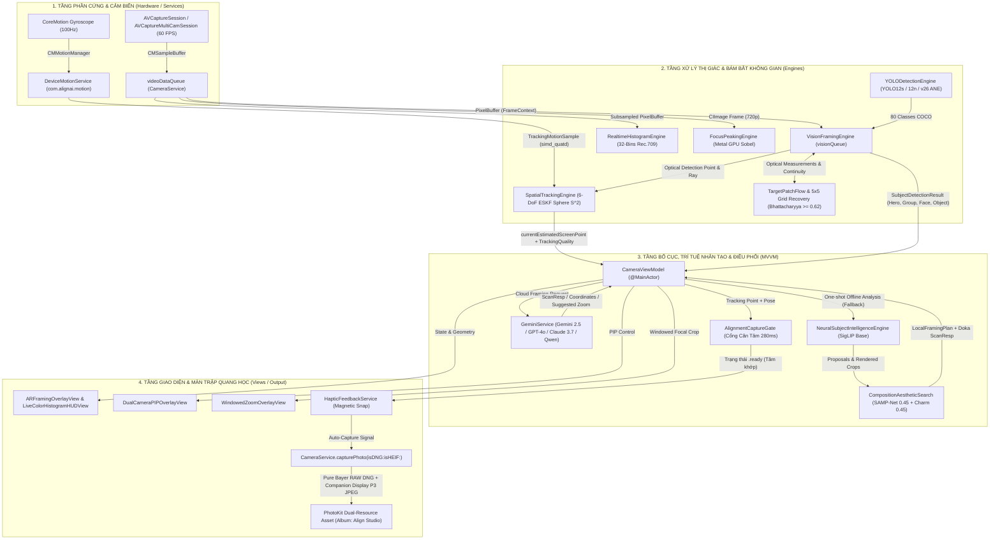

# BỘ NÃO DỰ ÁN (CODEBASE BRAIN) - ALIGN STUDIO (ALIGN-AI CAMERA)

> **Tài liệu tham chiếu tối thượng dành cho AI và Kỹ sư phát triển.**
> Phiên bản cập nhật: **Tháng 11/2026** (Đồng bộ với commit `f60612c`).
> **NGUYÊN TẮC BẤT DI BẤT DỊCH**: Tuyệt đối không đoán mò, không tự ý xóa bỏ các cơ chế fix lỗi lịch sử, bảo vệ nghiêm ngặt ranh giới mã nguồn (`tests/TrackingBoundary.json` và `tests/PhotographicDetectionBoundary.json`). Mọi thay đổi phải đảm bảo các bài kiểm tra ranh giới và cân bằng cú pháp Swift luôn đạt 100% PASS.

---

## 1. TỔNG QUAN KIẾN TRÚC & SƠ ĐỒ LUỒNG DỮ LIỆU THỰC TẾ

Align Studio là hệ thống máy ảnh nhiếp ảnh điện ảnh thông minh chuyên nghiệp trên iOS (iOS 17.0+ đến iOS 18+), kết hợp sâu giữa phần cứng camera Apple ISP 48MP Quad-Bayer, cảm biến chuyển động 6-DoF CoreMotion (100Hz), chip gia tốc Apple Neural Engine (ANE), hệ thống phát hiện thị giác lai (Apple Vision + YOLOv26 / YOLO12s / YOLO12n), các mô hình thẩm mỹ nhiếp ảnh cục bộ (SAMP-Net BMVC 2021 + Charm DINOv2 PARA 2025), cùng cổng kết nối đa mô hình Cloud AI 2026 (Google Gemini 2.5, OpenAI GPT-4o, Anthropic Claude 3.7, DeepSeek, OpenRouter Qwen) tự động Fallback về 100% AI Local trên vi xử lý ANE.

### 1.1. Sơ đồ Luồng Dữ Liệu Thời Gian Thực (Runtime Data Flow)



### 1.2. Vòng Đời Trạng Thái AI Capture (AI State Machine Lifecycle)

Hệ thống tuân thủ cỗ máy trạng thái nghiêm ngặt trong `AISessionState`:
$$\text{idle} \longrightarrow \text{analyzing} \longrightarrow \text{targetPlaced} \longrightarrow \text{alignmentPerfect} \longrightarrow \text{capturing} \longrightarrow \text{done}$$

1. **`idle`**: Camera xem trước bình thường, không ghim mục tiêu. Tâm ngắm chữ thập trung tâm và các vòng tròn AR được ẩn hoàn toàn để giữ khung hình sạch sẽ.
2. **`analyzing`**: Người dùng nhấn nút AI (`nutAI`) hoặc chạm chọn chủ thể trên màn hình. Hệ thống lấy snapshot khung hình hiện tại và gửi phân tích:
   - *Luồng Cloud*: Gửi sang `GeminiService` với cơ chế thử chuỗi mô hình (Gemini 2.5 Flash/Pro, GPT-4o, Claude 3.7, DeepSeek, Qwen) có timeout 38 giây và tự động loại bỏ thẻ suy nghĩ `<think>`.
   - *Luồng Fallback Local*: Nếu không có mạng hoặc API lỗi, tự động chuyển về `NeuralSubjectIntelligenceEngine` (SigLIP Base Image + SAMP-Net + Charm DINOv2 PARA) trong vòng < 100ms.
3. **`targetPlaced(locked: Bool)`**: Điểm ngắm bố cục vàng xuất hiện dưới dạng vòng tròn đôi (`TargetCircleView`). Tâm quang học trắng (`CurrentCenterCrosshair`) xuất hiện ở trung tâm kèm đường ray định hướng (`GuidanceRayLine`). Vòng tròn mục tiêu được neo vững chắc vào không gian thế giới thực qua `SpatialTrackingEngine` (6-DoF ESKF).
4. **`alignmentPerfect`**: Người dùng lia máy đưa tâm trắng khớp vào vòng vàng mục tiêu ($distance \le radius \cdot 1.05$). Cổng `AlignmentCaptureGate` kích hoạt:
   - Phát rung xúc giác dứt khoát `triggerMagneticSnap()`.
   - Khóa cứng toạ độ mục tiêu (`lockHardTarget()`) tại $(0.5, 0.5)$ để chống trôi giật do nhiễu micro pixel.
   - Kiểm tra và thực thi Zoom quang học thông minh tự động (`triggerZoomRevealAnimation(targetZoom:)`).
   - Tích lũy thời gian duy trì (Dwell Time $\ge 280\text{ms}$). Vòng chuyển sang màu xanh lục neon (`isAligned = true`) khi khớp hoàn hảo.
5. **`capturing`**: Rung phản hồi màn trập `triggerShutterClick()`, màn hình chớp sáng nhẹ, `CameraService.capturePhoto` được gọi trên `sessionQueue`.
6. **`done`**: Ảnh hoàn tất xử lý ISP, lưu tài nguyên kép RAW DNG + JPEG vào thư viện Photos, hiển thị thumbnail ảnh mới chụp ở góc trái dưới.

---

## 2. BẢN ĐỒ CHI TIẾT 4 TẦNG KIẾN TRÚC & CƠ CHẾ FIX LỖI ĐẶC BIỆT

### 2.1. Tầng 1: Tầng Camera & Cảm biến (Hardware & Services)

#### `CameraService.swift`
- **Quyền sở hữu**: Sở hữu độc quyền `AVCaptureSession`, `sessionQueue`, `videoDataQueue`, `photoProcessingQueue`. Mọi tương tác trực tiếp với `AVCaptureDevice` bắt buộc phải qua `scheduleDeviceConfiguration(after:operation:)` có khối `defer { camera.unlockForConfiguration() }`.
- **Hệ thống Zoom & Hysteresis**:
  - `convertDisplayZoomToDeviceZoom(_:)` và `convertDeviceZoomToDisplayZoom(_:)`: Chuyển đổi chính xác giữa tỷ lệ zoom hiển thị (UI) và zoom phần cứng.
  - `resolveOpticalLensTarget(for:)`: Thuật toán ngưỡng trễ chống nhảy ống kính quang học vật lý (Dải trễ 1.98x / 1.65x).
- **Chụp ảnh 48MP ISP & RAW DNG**:
  - `updateMaxPhotoDimensions`: Khai thác kích thước tối đa cảm biến 48MP Quad-Bayer.
  - `capturePhoto(isDNG:isHEIF:highResolution:)`: Cấu hình `AVCapturePhotoSettings`. Tuyệt đối không gọi `photoSettings.photoQualityPrioritization` khi chụp RAW DNG vì AVFoundation sẽ ném ngoại lệ crash `NSInvalidArgumentException`.
  - Không can thiệp CIRAWFilter hay tone-mapping giả mạo vào luồng byte RAW cảm biến.
- **Dual Camera MultiCam**:
  - Quản lý `secondaryVideoDataOutput` và `secondaryPreviewLayer` trên camera trước (720p @ 30fps) với cờ `alwaysDiscardsLateVideoFrames = true` để chống quá nhiệt và rò rỉ RAM.
- **Ranh giới bảo vệ**: Được bảo vệ bởi `tests/TrackingBoundary.json` (Khối `CameraService.swift`).

#### `DeviceMotionService.swift`
- **Nhiệm vụ**: Đọc dữ liệu con quay hồi chuyển CoreMotion tần số 100Hz (`1 / 60.0` đến `1 / 100.0`s).
- **Chuyển đổi hình học**: Chuyển ma trận quay $3 \times 3$ của CoreMotion thành quaternion định hướng toàn cầu `simd_quatd` qua phép chuyển vị: `simd_quatd(worldToDevice.transpose)` bằng hệ quy chiếu `.xArbitraryZVertical`.
- **An toàn luồng**: Sử dụng `streamGeneration` và `legacyGeneration` có khóa `NSRecursiveLock`. Callback phát ngoài lock, không bao giờ gọi đồng bộ (sync) lên Main Thread.

#### `HapticFeedbackService.swift`
- **Bộ sinh rung**: Quản lý `UIImpactFeedbackGenerator(style: .rigid, .medium, .light, .soft)`, `UISelectionFeedbackGenerator`, `UINotificationFeedbackGenerator`.
- **Debounce**: `triggerMagneticSnap()` có cờ debounce 0.35s ngăn ngừa hiện tượng mỏi rung phản hồi xúc giác.

#### `SuperResolutionRAWEngine.swift` & `SuperResolutionMetalShaders.swift`
- Dữ liệu DNG từ cảm biến được lưu giữ 100% byte gốc.
- `decodeProcessedPhoto(_:context:)`: Giải mã ảnh JPEG/HEIF hiển thị đồng hành, đọc đúng cờ hướng ảnh EXIF (`CGImagePropertyOrientation`) một lần duy nhất, xuất ra không gian màu Display P3.

#### `FocusPeakingEngine.swift`
- Động cơ báo nét điện ảnh thời gian thực 60 FPS gia tốc GPU Metal thông qua `CIContext(mtlDevice:)`.
- Thuật toán ma trận Sobel Edge Detection kết hợp Color Matrix 4 màu neon (Xanh Lá, Vàng Kim, Đỏ, Xanh Dương), tự động downscale xuống chiều rộng 720px để tiết kiệm tài nguyên GPU.

#### `DualCameraAssetRecorder.swift`
- Ghi hình video kép PIP đồng thời vào file MP4 (HEVC/H.264 1080p @ 30fps) bằng `AVAssetWriter` và `AVAssetWriterInputPixelBufferAdaptor`.
- Hòa trộn ảnh chụp 2 mặt bằng Core Image `CIContext` theo kích thước và vị trí viền an toàn thực tế trên màn hình.

#### `FilmFilterEngine.swift` & `Services/FilmSimulations/*`
- Thư viện 62 công thức màu phim kinh điển phân nhóm: Trending, Vintage Phone, Fuji (Pro 400H, Velvia, Classic Chrome), Vintage Cam (1998, Cinestill), CCD Digicam, Kodak (Portra 400, Gold 200), Ricoh GR (High B&W, Positive), Canon CCD, Mini DV.
- Chạy trên không gian màu Display P3 với cơ chế giải phóng bộ nhớ `clearCache()`.

---

### 2.2. Tầng 2: Tầng AI & Tracking (Engines)

#### `VisionFramingEngine.swift`
- **Theo dõi quang học**: Quản lý chuỗi tracking `VNTrackObjectRequest` với độ chính xác `.accurate`.
- **Bảo toàn chuỗi quan sát**: Duy trì `VisionContinuityPolicy` (chấp nhận mất dấu tối đa 6 khung hình ngắn hạn trước khi chuyển sang tái nhận diện).
- **Thuật toán quét lưới 5x5 phục hồi mục tiêu (Budgeted Grid Search)**: Khi mất dấu $\ge 20$ khung hình, quét tuần tự 25 ô trên lưới $5 \times 5$, mỗi frame chỉ kiểm tra 2-3 ô ngân sách để không tụt 60 FPS.
- **Bộ lọc màu Bhattacharyya**:
  $$\text{similarity} = \sum \sqrt{h_{\text{ref}} \cdot h_{\text{curr}}} \ge 0.62$$
  Lọc bỏ 95% vùng sai chỉ trong 0.05 ms trước khi đưa vào mạng nơ-ron FeaturePrint so khớp.
- **ANE Cadence Throttling**: Nhịp nhanh (Face, Human, YOLO) chạy mỗi frame; Nhịp chậm (Horizon, Classify, Saliency) chạy mỗi 5 frame để giữ máy luôn mát.
- **Ranh giới bảo vệ**: Được bảo vệ bởi `tests/TrackingBoundary.json`.

#### `SpatialTrackingEngine.swift`
- **Thuật toán cốt lõi**: Error-State Kalman Filter (ESKF) trên mặt phẳng tiếp xúc mặt cầu đơn vị $S^2$.
- Theo dõi vector định hướng mục tiêu trong thế giới thực $\vec{r} \in \mathbb{R}^3 (||\vec{r}|| = 1)$ và vận tốc góc quay $\vec{\omega}$ (rad/s).
- **Cổng Mahalanobis Innovation Gating**:
  $$\chi^2 = \vec{y}^T S^{-1} \vec{y} \le 16.0 \quad (\le 25.0 \text{ cho bối cảnh chuyển động/đường phố})$$
- **Lọc rung thích ứng Hermite Smoothstep**:
  $$\text{motionFraction} = \text{clamp}\left(\frac{\text{residual} - 0.02}{0.08}, 0, 1\right)$$
  $$\text{motionGain} = \text{motionFraction}^2 \cdot (3 - 2 \cdot \text{motionFraction}) \cdot K_{\text{evidence}}$$
  Khi máy đứng yên: chuyển về `ordinaryGain` tần số thấp; khi lia máy nhanh hoặc chủ thể di chuyển: chuyển mượt mà sang `motionGain`.
- **Ranh giới bảo vệ**: Được bảo vệ bởi `tests/TrackingBoundary.json`.

#### `TargetPatchFlow.swift`
- Bám bắt luồng quang học ma trận cục bộ (Local Patch Correspondence) độc lập với kích thước hộp Vision.
- Trích xuất điểm đặc trưng bề mặt theo giá trị riêng nhỏ nhất Shi-Tomasi ($\ge 16.0$) trên ảnh xám chuẩn hóa độ sáng.
- **Ranh giới bảo vệ**: Được bảo vệ bởi `tests/TrackingBoundary.json`.

#### `TrackingGeometry.swift`
- `TrackingCalibration`: Lưu thông số nội tại camera $f_x, f_y, c_x, c_y, \text{aspect}$.
- Phép bắn tia lỗ kim (`deviceRay`) và phép chiếu ngược (`project`). Khi mục tiêu ở sau lưng camera ($forward \le 0$), chuyển sang hệ tọa độ góc cầu để dẫn đường con trỏ chính xác về mép màn hình mà không bị đảo ngược vector.
- `dock`: Ghim con trỏ mục tiêu vào viền màn hình (Edge Docking) với khoảng đệm an toàn 30px khi đối tượng trôi ra ngoài tầm nhìn (Off-screen).
- **`AlignmentCaptureGate`**:
  - Trạng thái: `.outside`, `.holding`, `.ready`.
  - Ngưỡng vào: $1.0\times$, ngưỡng giữ chống rung: $1.45\times$, vùng dung sai: $2.2\times$ bán kính.
  - Dwell time yêu cầu: $\ge 0.28\text{s}$ (280ms).
  - Hỗ trợ `lockTarget()` và `unlockTarget()` đồng bộ với cơ chế Hard Lock.
- **Ranh giới bảo vệ**: Được bảo vệ bởi `tests/TrackingBoundary.json`.

#### `YOLODetectionEngine.swift`
- Tải và điều phối các mô hình Core ML gia tốc ANE: `yolo12s`, `yolo12n`, `yolov26_416_fp16`, `yolov26_ane`.
- Nhận diện 80 lớp đối tượng chuẩn COCO, phân loại thành: `.face`, `.human`, `.animal`, `.foregroundObject`.
- Ngưỡng tin cậy động thích ứng ánh sáng yếu: Khi độ sáng cảnh $< 0.35$, sử dụng `yoloLowLightConfidenceThreshold` (0.28) thay vì ngưỡng mặc định (0.48).

#### `NeuralSubjectIntelligenceEngine.swift`
- Phân tích ngữ cảnh ảnh tĩnh chụp một chạm bằng Google SigLIP (`SigLIPBaseImage.mlmodelc` + `SigLIPPrompts.json`), giải phóng model ngay khi phân tích xong để tiết kiệm RAM.
- Hero Subject Policy: Tính điểm diện tích, danh mục, liên kết khuôn mặt với thân mình, mật độ chú ý, độ tương phản cục bộ.
- Phân loại đường cắt thân mình an toàn cho ảnh chụp chân dung (`PortraitFramingEvidence`), tránh cắt trúng khớp ngón tay/khuỷu tay.

#### `PhotographicCompositionModel.swift` & `CharmPhotographicModel.swift`
- `PhotographicCompositionModel`: Mô hình SAMP-Net (BMVC 2021) chấm điểm bố cục 5 mức trên tập CADB, kết hợp bản đồ chú ý quang phổ `SpectralCompositionSaliency`.
- `CharmPhotographicModel`: Mô hình Charm (2025) DINOv2-small 21.5M tham số đánh giá thẩm mỹ ảnh nhiếp ảnh PARA (9-bin distribution).
- Trọng số kết hợp chuẩn: 0.45 SAMP-Net + 0.45 Charm + 0.10 Hình học.

#### `GeminiService.swift`
- Tích hợp đa mô hình Cloud AI 2026: Gemini 2.5 Flash/Pro, GPT-4o, Claude 3.7 Sonnet, DeepSeek Chat, OpenRouter Qwen.
- **Các bản fix gần đây**:
  - Tự động chuẩn hóa Model ID (`normalizeModelID`) cho các nhà cung cấp khác nhau.
  - Mở rộng timeout kết nối Cloud lên 38 giây để đảm bảo không bị rớt mạng đối với các mô hình suy luận sâu.
  - Tự động tách và loại bỏ thẻ suy nghĩ `<think>...</think>` trong phản hồi JSON từ Qwen/DeepSeek.
  - Chuẩn hóa đầu ra định dạng Doka `ScanResp`, trích xuất `SubAreaRectNorm` và tọa độ mục tiêu `(targetX, targetY)`.
  - Giữ nguyên 100% tọa độ dẫn hướng do Cloud AI chỉ định (`aimPoint = CGPoint(x: response.targetX, y: response.targetY)`), không kéo ép lệch về tâm mặt.

---

### 2.3. Tầng 3: Tầng Bố cục & Điều phối (Intelligence & ViewModel)

#### `CompositionCalculator.swift`
- Đấu loại khung cắt ảo đa tỷ lệ (`evaluateVirtualCropZooms`) theo kích thước tuyến tính 1D (`baseLinearSize = height` cho người, $\max(w, h, \sqrt{area})$ cho vật thể).
- **Quy tắc chân dung bán thân (Medium / Half-body Shot)**: Miễn phạt tràn đáy cho phần chân của con người (`human`), cho phép AI đề xuất zoom 2.0x / 3.0x chụp nửa người nghệ thuật mà không bị trừ điểm.
- **Pre-Zoom Target Projection**:
  $$\text{Target}.x = S_{\text{anchor}}.x - \frac{P_{\text{grid}}^*.x - 0.5}{k}, \quad \text{Target}.y = S_{\text{anchor}}.y - \frac{P_{\text{grid}}^*.y - 0.5}{k}$$
  với $k = \max(0.5, Z^* / \text{currentZoom})$.
- **Horizon X/Y Decoupling**: Khi cảnh phẳng không có điểm tụ ngang, giữ $P_{\text{grid}}.x = S_{\text{anchor}}.x$ ($\Delta X = 0$) để chỉ hướng dẫn chỉnh góc ngẩng/cúi mà không ép xoay ngang vô lý.
- **Quán tính chủ thể (Subject Persistence)**: Thưởng điểm +0.25 IoU duy trì chủ thể của khung trước, triệt tiêu việc nhảy sang mặt người lạ ở xa.

#### `CompositionPlanning.swift`
- Đề xuất bố cục nhiếp ảnh (`photographicProposals`) và bảo vệ các nhân vật đi cùng (`CompositionCropProtection.protectedBounds`).
- **Bản fix hồi quy `fb4c02f`**: Khôi phục phép quay `simd_quatd(from:to:)` giữa vector tia tương lai và vector tia hiện tại:
  `let rotation = simd_quatd(from: future.deviceRay(at: destination), to: calibration.deviceRay(at: subject.anchor))`
  đảm bảo vượt qua 100% các bài test bố cục chuẩn.

#### `CameraViewModel.swift`
- Trục điều phối trung tâm MVVM trên `@MainActor`, quản lý toàn bộ cỗ máy trạng thái `aiSessionState`.
- **Cơ chế Khóa Cứng (Hard Lock) & Chống Trôi Mục Tiêu**:
  - `lockHardTarget()`: Khi đạt cờ snap/aligned, chốt cứng `currentTargetPoint = CGPoint(x: 0.5, y: 0.5)`, ghi nhận `lockedDevicePose` và gọi `alignmentGate.lockTarget()`.
  - `unlockHardTargetLock()`: Tự động mở khóa khi đã chụp xong, khi người dùng đổi chế độ, chạm lấy nét lại, hoặc khi người dùng chủ động lia máy đi chỗ khác với góc quay tích lũy Gyro vượt ngưỡng.
- **Bộ lọc làm mượt chống nhảy Target (Deadband & Slew-rate)**:
  - Deadband: Nếu độ lệch $\Delta d < 0.004$ và vận tốc góc Gyro $< 0.15\text{ rad/s}$, giữ nguyên vị trí cũ.
  - Slew-rate Limiter: Giới hạn vận tốc trôi tâm tối đa 0.60 units/s khi máy tĩnh để tâm lướt êm ái, tăng giới hạn thích ứng khi lia máy nhanh ($\ge 0.35\text{ rad/s}$).
- **Các bản fix gần đây**:
  - `00947a0`: Tách biệt hoàn toàn `isSnapped` (amberGold/cyan) và `isAligned` (green) trong UI; mở rộng giới hạn an toàn zoom cho chủ thể nằm lệch tâm (`boundsReasonable = projectedMinX >= -0.65 && projectedMaxX <= 1.65...`); nới lỏng góc nghiêng chân trời (`abs(currentRollDegrees) > 8.0` kết hợp kiểm tra `isHorizonLevelerEnabled`).
  - `f60612c`: Unwrap an toàn biến tùy chọn `aiSuggestedZoom` trong hàm `canZoomCurrentSubject(to:)`.
  - `a3e13c8`: Đồng bộ hóa tia ngắm `finalGuideRay` và `finalLiveAim` theo đúng tâm của khung `SubAreaRectNorm` trong mô hình Doka ScanResp.

---

### 2.4. Tầng 4: Tầng Giao diện (Views / HUD)

#### `ARFramingOverlayView.swift`
- Vẽ lớp phủ đồ họa AR thời gian thực:
  - `TargetCircleView`: Vòng tròn mục tiêu kép có hiệu ứng hào quang thở nhịp nhàng. Khi `isAligned = true`, hiển thị màu xanh lục neon; khi `isSnapped = true`, hiển thị gradient vàng kim pha cyan; khi bám bắt bình thường, hiển thị viền vàng SenseTime.
  - `CurrentCenterCrosshair`: Tâm ngắm chữ thập màu trắng nằm chính giữa màn hình (ẩn khi `idle`).
  - `GuidanceRayLine`: Đường ray kết nối từ tâm trắng đến vòng vàng mục tiêu với đầu mũi tên chevron.
  - `ZoomRevealOverlay`: Hiệu ứng làm mờ viền ngoài và mở rộng khung ngắm trung tâm khi hệ thống kích hoạt zoom quang học AI.
  - `HorizonLevelerView`: Thước thủy điện tử đo độ nghiêng máy chuẩn 0.1 độ, tự chuyển màu vàng kim khi góc nghiêng đạt độ phẳng tuyệt đối.

#### `LiveColorHistogramHUDView.swift`
- Hiển thị biểu đồ Waveform phổ màu RGB 32 băng tần (SwiftUI Canvas) với 3 đường cong Red, Green, Blue độc lập và các sợi chỉ phổ màu (Spectral Needles).
- Chạm vào biểu đồ để chuyển đổi nhanh giữa các định dạng lưu ảnh: RAW DNG, HEIF, JPEG.

#### `CameraControlsView.swift`
- Cụm điều khiển 3 cột đối xứng: Cột trái (Album), Cột giữa (Nút chụp màn trập 80pt căn chính giữa trục), Cột phải (Lật camera).
- Hàng thứ 2: Nút AI (`nutAI` không nền), Bộ chuyển chế độ ẢNH / VIDEO, và Nút mở khay 62 màu phim.

#### `DualCameraPIPOverlayView.swift`
- Khung nhìn camera trước chuẩn PIP viền trắng thanh lịch (`Color.white.opacity(0.92)`).
- Hỗ trợ Double-tap đổi nhanh 3 kích cỡ (1.0x, 1.35x, 1.70x), MagnificationGesture zoom tự do (0.75x đến 1.8x), DragGesture di chuyển tự do với cơ chế bám biên thông minh chống tràn viền.

#### `WindowedZoomOverlayView.swift`
- Khung ngắm Rangefinder thu nhỏ quang học với các tiêu cự điện ảnh (24mm, 28mm, 35mm, 50mm, 75mm, 85mm).
- Cắt ảnh và video chuẩn xác từng pixel, tâm khung ngắm luôn căn đúng trung tâm chủ thể cần nhấn mạnh.

---

## 3. CÁC QUY ƯỚC KỸ THUẬT VÀ NGUYÊN TẮC BẢO VỆ MÃ NGUỒN

### 3.1. Quy ước Luồng & Quản lý Hàng Đợi (Threading & Queues)

| Tài nguyên / Tác vụ | Hàng đợi quản lý (Queue) | Quy tắc an toàn |
| :--- | :--- | :--- |
| `AVCaptureSession`, cấu hình camera | `CameraService.sessionQueue` (serial) | Mọi truy cập `AVCaptureDevice` phải qua `scheduleDeviceConfiguration`, không block main |
| Nhận dữ liệu frame camera thô | `CameraService.videoDataQueue` (serial) | Luôn drop frame muộn (`alwaysDiscardsLateVideoFrames = true`), không bao giờ xử lý nặng trực tiếp |
| Xử lý Vision & Tracking quang học | `VisionFramingEngine.visionQueue` (serial) | `autoreleaseFrequency: .workItem`, kiểm tra thường xuyên cờ hủy `cancellation` |
| Dữ liệu con quay hồi chuyển CoreMotion | `DeviceMotionService.queue` (serial) | Bảo vệ bằng `NSRecursiveLock`, callback phát ngoài lock, không đợi MainActor |
| Ghi hình Dual Camera PIP | `DualCameraAssetRecorder.recordQueue` (serial) | Chạy ngầm `userInitiated`, tuần tự hóa buffer ghi |
| Cập nhật trạng thái hiển thị SwiftUI | `CameraViewModel` (`@MainActor`) | Chỉ cập nhật các thuộc tính `@Published` trên MainActor |

### 3.2. Quản lý Bộ nhớ và Tài nguyên GPU/ANE

1. **Không tạo rò rỉ CVPixelBuffer**: Mọi thao tác truy cập địa chỉ cơ sở (`CVPixelBufferGetBaseAddress`) bắt buộc phải có `defer { CVPixelBufferUnlockBaseAddress(...) }`.
2. **Tái sử dụng CIContext**: Không khởi tạo `CIContext` mới trong mỗi khung hình. Sử dụng context dùng chung gắn với Metal device (`CIContext(mtlDevice: options:)`).
3. **Giải phóng mô hình Core ML**: Các mô hình nặng (`SigLIPBaseImage`, `Charm`, `SAMPComposition`) chỉ được nạp khi có yêu cầu phân tích một chạm (one-shot), giải phóng ngay khi hoàn thành để nhường RAM cho hệ thống.

### 3.3. Quy ước Hệ Tọa Độ & Hình Học

- **Hệ tọa độ Vision**: Gốc $(0, 0)$ ở góc **Dưới - Trái**, $x$ sang phải $[0, 1]$, $y$ hướng lên $[0, 1]$.
- **Hệ tọa độ Upright (Chuẩn nội bộ dự án)**: Gốc $(0, 0)$ ở góc **Trên - Trái**, $x$ sang phải $[0, 1]$, $y$ hướng xuống $[0, 1]$.
- **Công thức chuyển đổi**:
  $$y_{\text{upright}} = 1.0 - y_{\text{vision}} - \text{height}$$
  $$y_{\text{vision}} = 1.0 - y_{\text{upright}} - \text{height}$$
- **Hệ tọa độ màn hình (Screen Space)**: Áp dụng phép chiếu tương thích tỷ lệ tràn viền AspectFill qua `TrackingGeometry.screenPoint`.

### 3.4. Ranh giới Khóa Mã Nguồn (Boundary Protection Manifests)

Dự án cài đặt hệ thống kiểm tra tự động mã băm SHA-256 qua script `scripts/verify_tracking_boundary.py`:
- **`tests/TrackingBoundary.json`**: Bảo vệ 17 khối mã nguồn cốt lõi của hệ thống tracking và cổng căn tâm (`CameraService.swift`, `DeviceMotionService.swift`, `VisionFramingEngine.swift`, `SpatialTrackingEngine.swift`, `TargetPatchFlow.swift`, `TrackingGeometry.swift`, `CameraViewModel.swift`, `ARFramingOverlayView.swift`).
- **`tests/PhotographicDetectionBoundary.json`**: Bảo vệ 3 khối mã nguồn của hệ thống nhận diện và gom nhóm chủ thể (`NeuralSubjectIntelligenceEngine.swift`).
- **Yêu cầu nghiêm ngặt**: Khi chỉnh sửa code, **TUYỆT ĐỐI KHÔNG** làm thay đổi bất kỳ ký tự nào trong các vùng được bảo vệ, trừ khi có yêu cầu nâng cấp được phê duyệt rõ ràng kèm theo việc cập nhật hash manifest.

---

## 4. BẢNG TỔNG HỢP CÁC LỆNH KIỂM CHỨNG TOÀN DIỆN

Trước khi hoàn thành bất kỳ tác vụ nào, phải chạy các script kiểm tra sau:

```powershell
# 1. Kiểm tra ranh giới mã nguồn được bảo vệ (Bắt buộc PASS 100%)
& "C:\Users\admin\AppData\Local\Programs\Python\Python312\python.exe" scripts/verify_tracking_boundary.py

# 2. Kiểm tra cân bằng cú pháp ngoặc trong toàn bộ 67 file Swift
& "C:\Users\admin\AppData\Local\Programs\Python\Python312\python.exe" scripts/check_swift_brackets.py

# 3. Kiểm tra tính toán bố cục co giãn trên 4 kích thước màn hình iPhone
& "C:\Users\admin\AppData\Local\Programs\Python\Python312\python.exe" scripts/check_responsive_layout.py
```

---

## 5. LỊCH SỬ CÁC BẢN FIX LỖI GẦN NHẤT CẦN LƯU TÂM

1. **`f60612c`**: Sửa lỗi crash compiler khi unwrap optional `aiSuggestedZoom` trong hàm `canZoomCurrentSubject`.
2. **`00947a0`**: 
   - Khắc phục hiện tượng "fake green snap": Tách màu vòng ngắm khi Snap xúc giác (`isSnapped`: amberGold/cyan) và khi khớp căn tâm thực tế (`isAligned`: xanh lục neon).
   - Mở rộng giới hạn boundsReasonable $[-0.65 \dots 1.65]$ để không chặn tự động zoom khi chủ thể nằm lệch tâm.
   - Nới lỏng kiểm tra cân bằng chân trời `abs(currentRollDegrees) > 8.0` và chỉ áp dụng khi người dùng bật `isHorizonLevelerEnabled`.
3. **`fb4c02f`**: Khôi phục phép quay `simd_quatd(from:to:)` trong `CompositionPlanning.swift` line 641 để vượt qua các bài kiểm tra bố cục hình học.
4. **`02caaf4`**: Xóa bỏ các biến không sử dụng trong `CameraViewModel.swift` để vượt qua cờ kiểm tra nghiêm ngặt `-warnings-as-errors`.
5. **`a3e13c8`**: 
   - Khóa upright look-at quaternion để triệt tiêu hiện tượng xoay 3D roll ngoài ý muốn.
   - Cho phép zoom liên tục đối với cảnh quan thiên nhiên (`scenery`).
   - Gắn kết mục tiêu ngắm vào đúng tâm của khung `SubAreaRectNorm` trong mô hình Doka.
   - Bảo toàn 100% điểm ngắm do Cloud AI trả về.
6. **`f682ba8`**:
   - Tự động chuẩn hóa Model ID khi gọi OpenRouter / Qwen.
   - Kéo dài deadline Cloud lên 38s để không ngắt kết nối sớm.
   - Tự động lọc bỏ thẻ `<think>` trong chuỗi JSON trả về.
7. **`3ffe8c6`**: Tích hợp chuẩn dữ liệu Doka `ScanResp`, `SubAreaRectNormModel`, `AiCameraFilterModel`, `ScanRespData`, hỗ trợ Plan 2 Telephoto 50mm (2.0x) và căn giữa bố cục.
