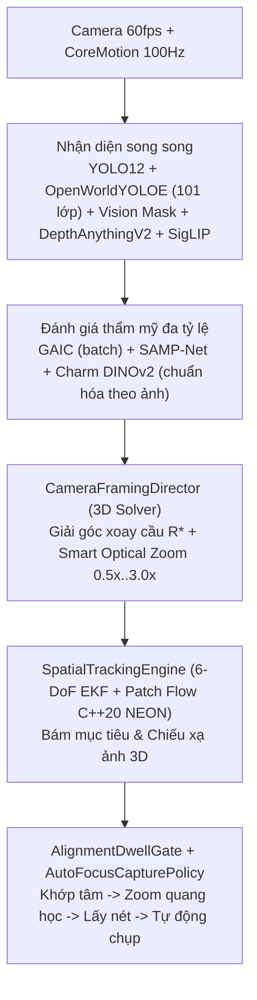

# Align Studio — AI Compose App (iOS)

**Align Studio** là ứng dụng camera nhiếp ảnh và quay phim mã nguồn mở cho **iOS 17+**, xây dựng bằng **Swift, SwiftUI, Metal, Apple Vision, CoreML (Apple Neural Engine)** và **C++20 NEON**.

Ứng dụng tập trung vào bài toán **AI Compose (gợi ý bố cục & dẫn hướng góc máy 3D theo thời gian thực)**: phân tích khung hình trực tiếp trên iPhone, xác định chủ thể (người, khuôn mặt, thú cưng, hoa lá, mây trời, kiến trúc, món ăn, đồ vật thường ngày…), tính toán hướng xoay máy + mức zoom quang học tối ưu (`0.5x` – `3.0x`), rồi dẫn đường bằng tâm ngắm 6-DoF để tự động zoom và chụp khi khung hình đạt độ cân bằng.

---

## 1. Giới thiệu ứng dụng

- **Nền tảng**: iOS 17.0+ (tối ưu cho Apple Neural Engine từ A11 đến A18 Pro; khuyến nghị RAM `>= 6 GB` để chạy đầy đủ toàn bộ chuỗi model CoreML song song).
- **Triết lý thiết kế**: Giao diện tối giản chuẩn máy ảnh chuyên nghiệp (tông carbon trầm, kính mờ nhẹ, không preset màu áp sẵn làm sai lệch màu gốc cảm biến trừ khi người dùng chủ động chọn hoặc bật AI Auto Color).
- **Hoạt động Offline 100%**: Toàn bộ chuỗi nhận diện chủ thể, ước lượng chiều sâu, chấm điểm thẩm mỹ và dẫn hướng 3D chạy hoàn toàn trên thiết bị. Chế độ AI Cloud là tùy chọn mở rộng và tự động chuyển mượt về AI Local khi mất mạng hoặc không có API key.
- **Phát hành**: Tự động kiểm thử native Swift/C++, xuất & kiểm parity CoreML, biên dịch unsigned `.ipa` (Sideloadly / AltStore / TrollStore) qua GitHub Actions ([Tải bản phát hành mới nhất](https://github.com/emlavankhoahienma-hue/ai-smart-framing-camera/releases/latest)).

---

## 2. Chức năng chính

### AI Compose & Dẫn hướng chụp
- **Gợi ý bố cục 3D (AI Compose)**: Giải góc xoay máy thực tế trong không gian 3D để đưa chủ thể / ánh mắt / cụm hoa / đường chân trời vào đúng điểm **Tỷ lệ vàng**, **Luật 1/3**, **Khoảng thở hướng nhìn (Lead Room)** hoặc **Đối xứng kiến trúc**.
- **Smart Optical Zoom 2 chiều**: Tự đề xuất lùi góc rộng `0.5x` khi chủ thể quá sát hoặc bị cắt viền, hoặc tiến quang học `1.2x / 1.5x / 2.0x / 3.0x` khi chủ thể ở xa, ưu tiên các nấc ống kính vật lý.
- **Bám mục tiêu 6-DoF & Căn tâm tự chụp**: Chấm mục tiêu bám không gian thực theo con quay hồi chuyển 100Hz + luồng quang học 30Hz; khi đưa tâm trắng vào khớp tâm vàng, hệ thống rung phản hồi, tự thực thi mức zoom đề xuất, khóa nét và tự động chụp.
- **AI Cloud tùy chọn + Local Fallback**: Hỗ trợ kết nối Gemini / OpenAI-compatible API và tự động lùi về 100% AI Local nếu offline hoặc lỗi mạng.

### Công cụ Camera & Quay phim Pro
- **Chụp ảnh chất lượng gốc**: Hỗ trợ cảm biến **48MP / 12MP ISP gốc**, **RAW DNG** nguyên bản, **Ultra Sharp** ghép đa khung Metal, và **Dual Camera (MultiCam PIP)** chụp/quay 2 mặt đồng thời.
- **Windowed Zoom & Lưới đa chế độ**: Khung ngắm rangefinder cố định ống kính chính; nút lưới chuyển đổi xoay vòng (`Tắt → 1/3 → Tỷ lệ vàng → Đường chéo → 4×4 → Tâm ngắm`).
- **Pro HUD & Histogram Rec.709 48-bin**:
  - Đồ thị quang phổ Luma + R/G/B thật nội suy mượt trên GPU (không dùng timer, không giả lập).
  - Cảnh báo trực tiếp **Cháy sáng (`HI`)** và **Nhiễu cao (`NS`)** đo từ nhiễu phẳng pixel + ISO cảm biến mà không che khung ngắm.
  - Đi kèm thước cân bằng chân trời (**Horizon Leveler**), **Focus Peaking Metal**, đồng hồ âm thanh **Audio VU Meter** và chỉnh tay thông số quay video.
- **Khung Master cho Ảnh & Video**: Đóng khung thông số EXIF chuyên nghiệp cho cả ảnh tĩnh và video (xuất qua `AVAssetReader` / `AVAssetWriter` giữ nguyên chất lượng gốc và passthrough âm thanh).
- **Màu phim Display P3**: Mặc định giữ màu tự nhiên của máy; hỗ trợ xem trước và áp công thức màu phim Display P3 hoặc bật AI tự chọn màu theo bối cảnh.
- **Thư viện Align Studio & Chi tiết ảnh**: Lưu trữ cục bộ an toàn (đọc chuẩn hướng EXIF), so sánh ảnh gốc/đã chỉnh, và **Mini-Map tương tác** hiển thị chính xác vùng đang phóng to.

---

## 3. Hệ thống Model AI

| Thành phần | Model thực tế | Vai trò trong AI Compose | Môi trường chạy |
| :--- | :--- | :--- | :--- |
| **Nhận diện chủ thể chuẩn (80 lớp)** | `YOLO12s` / `YOLO12n` + `YOLOv26-ANE` | Nhận diện người, thú cưng, đồ ăn, phương tiện, đồ vật COCO tốc độ cao | CoreML ANE (Local) |
| **Nhận diện mở rộng (101 lớp nhiếp ảnh)** | `OpenWorldPhotoYOLOE` (`yoloe-26s-seg` + `MobileCLIP2-B` nhúng offline) | Nhận diện các chủ thể ngoài COCO: hoa, lá, cây, bầu trời, mây, hoàng hôn, núi, biển, tòa nhà, chùa, cầu, cà phê, máy ảnh… | CoreML ANE (Local) |
| **Tách chủ thể không phân lớp** | Apple Vision `VNGenerateForegroundInstanceMaskRequest` | Tách mặt nạ pixel và tâm khối lượng chính xác cho vật thể lạ / tiền cảnh | iOS 17+ Vision (Local) |
| **Ước lượng chiều sâu đơn ảnh** | `DepthAnythingV2SmallF16INT8` (Apple CoreML) | Tách tiền cảnh / hậu cảnh, xác định khoảng trống nền và ước lượng đường chân trời | CoreML ANE (Local) |
| **Ngữ cảnh & phân tích nhiếp ảnh** | `SigLIP-Base-224` (48 prompt nhiếp ảnh) | Phân loại bối cảnh (chân dung, hoa cận cảnh, mây trời, hoàng hôn, nội thất, đường phố) và phát hiện rác viền | CoreML ANE (Local) |
| **Đánh giá khung cắt đa tỷ lệ** | `GAICCompositionScorer` | Chấm điểm thẩm mỹ cùng lúc tới 256 khung đa tỷ lệ chỉ trong 1 lượt forward | CoreML ANE (Local) |
| **Thẩm mỹ & bố cục chuyên sâu** | `SAMP-Net` + `Charm-PARA` (DINOv2) | Xác thực và đồng thuận xếp hạng thẩm mỹ chuẩn hóa theo từng ảnh | CoreML ANE (Local) |
| **Nhận diện khuôn mặt & tư thế** | Apple Vision (`FaceLandmarks`, `HumanBodyPose`, `Horizon`) | Xác định vị trí mắt, hướng nhìn (gaze), đầu/vai để tính headroom & lead room | Apple Vision (Local) |
| **AI Cloud (Tùy chọn)** | Gemini / OpenAI-compatible API | Phân tích ngữ nghĩa nâng cao khi có mạng & API key; tự fallback về Local | Cloud → Local |

> Toàn bộ model CoreML được kiểm tra mã băm SHA-256 và kiểm chứng sai số PyTorch ↔ CoreML ngay trên macOS CI (`scripts/verify_model_bundle.py`) trước khi đóng gói `.ipa`.

---

## 4. Thuật toán & Kiến trúc cốt lõi



### Các thuật toán chính
1. **Giải xoay máy 3D & Smart Optical Zoom (`CameraFramingDirector.swift`)**:
   - Không cắt ảnh tĩnh 2D cứng nhắc (vốn làm kẹt tâm ở `(0.5, 0.5)` khi ở `1.0x`), bộ điều phối giải trực tiếp phép xoay cầu quaternion `R* = simd_quatd(from: futureCalib.deviceRay(G*), to: sourceCalib.deviceRay(anchor))` để ánh xạ điểm neo chủ thể (mắt, tâm cụm hoa sắc nét, hoặc đường chân trời) vào đúng điểm bố cục `G*`.
   - Hợp nhất độ sâu `DepthAnythingV2` với độ nét biên để loại bỏ dải mờ sát đáy, giảm trọng số người bị cắt góc không thấy mặt, gộp cụm kiến trúc / nội thất cân bằng, và khóa cổng lùi `0.5x` chỉ khi khung thật sự chật.
2. **Đồng thuận thẩm mỹ chuẩn hóa theo từng ảnh (`CompositionAestheticSearch.swift`)**:
   - Chuẩn hóa điểm `GAIC`, `SAMP-Net` và `Charm-PARA` về cùng biên độ `[0, 1]` trên tập ứng viên của chính bức ảnh đó, ngăn điểm hình học viết tay lấn át đánh giá từ mạng nơ-ron.
3. **Bám mục tiêu không gian 6-DoF EKF & C++20 NEON (`SpatialTrackingEngine.swift`, `TargetPatchFlow.swift`, `NativeTrackingCore.cpp`, `TrackingGeometry.swift`)**:
   - Hợp nhất dữ liệu con quay hồi chuyển 100Hz với optical flow bám vùng ảnh (C++20 NEON SIMD), dùng đường cong Hermite smoothstep để vừa đứng im khi tay tĩnh vừa bám tức thì khi lia máy nhanh, kèm docking mép màn hình khi mục tiêu ra khỏi tầm nhìn.
4. **Cổng căn tâm chống rung & lấy nét phần cứng (`CompositionPureCalculations.swift`, `CameraViewModel.swift`)**:
   - `AlignmentDwellGate` yêu cầu duy trì trong bán kính khớp đồng bộ với vùng hút nam châm hiển thị, kèm vùng trễ chống rung tay; bảo vệ khóa cứng trong suốt quá trình ramp ống kính quang học rồi mới kích hoạt `AutoFocusCapturePolicy` và chụp.
5. **Quang phổ Rec.709 & Đo nhiễu cảm biến thời gian thực (`RealtimeHistogramEngine.swift`, `LiveColorHistogramHUDView.swift`)**:
   - Chuyển đổi ma trận BT.709 integer fixed-point tạo 48 bins Luma + R/G/B, làm mượt đỉnh tham chiếu P96 chống giật biên độ, đo đồng thời nhiễu phẳng pixel + ISO phần cứng, và nội suy mượt đường cong bằng SwiftUI `Animatable` (`VectorArithmetic`).
6. **Xử lý quang học & hình ảnh Metal / C++20 NEON (`NativeOpticsCore.cpp`, `UltraSharpMetalEngine.swift`, `FocusPeakingMetalProcessor.swift`, `HighFidelityVideoExporter.swift`)**:
   - Hiệu chỉnh méo rectilinear góc siêu rộng, gộp khung Ultra Sharp trên GPU Metal, báo nét Focus Peaking lọc nhiễu, và xuất video kèm khung Master giữ nguyên luồng âm thanh gốc.

### Bản đồ mã nguồn & Quy ước cho AI / Developer
- **Mã nguồn chính** (trong thư mục dự án iOS):
  - `Models/`: `FramingModels.swift` (kiểu dữ liệu, `HistogramTelemetry`, `AppPhotoStorageService` hỗ trợ EXIF orientation), `CameraFeatureGate.swift` (khóa điều kiện tính năng theo chế độ).
  - `Services/`:
    - AI Compose & CoreML: `CameraFramingDirector.swift`, `OpenWorldSubjectDetector.swift`, `NeuralSubjectIntelligenceEngine.swift`, `YOLODetectionEngine.swift`, `CompositionPlanning.swift`, `CompositionAestheticSearch.swift`, `CompositionImageEvidence.swift`, `GAICCompositionModel.swift`, `PhotographicCompositionModel.swift`, `CharmPhotographicModel.swift`, `CompositionCalculator.swift`, `GeminiService.swift`.
    - Tracking & Optics: `SpatialTrackingEngine.swift`, `StreetSpatialTrackingEngine.swift`, `TargetPatchFlow.swift`, `TrackingGeometry.swift`, `VisionFramingEngine.swift`, `NativeTrackingCore.cpp`, `NativeOpticsCore.cpp`.
    - Camera, HUD & Media: `CameraService.swift`, `RealtimeHistogramEngine.swift`, `FocusPeakingMetalProcessor.swift`, `UltraSharpMetalEngine.swift`, `FilmFilterEngine.swift`, `DualCameraAssetRecorder.swift`, `HighFidelityVideoExporter.swift`, `MasterWatermarkRenderer.swift`.
  - `ViewModels/`: `CameraViewModel.swift`.
  - `Views/`: `CameraMainView.swift`, `ARFramingOverlayView.swift`, `LiveColorHistogramHUDView.swift`, `CameraControlsView.swift`, `CapturedPhotoPreviewView.swift`, `PhotoGallerySheetView.swift`, `VideoPreviewSheetView.swift`, `SettingsSheetView.swift`.
- **Ranh giới bảo vệ bắt buộc (KHÔNG sửa trực tiếp vùng khóa)**:
  - `tests/TrackingBoundary.json` (19 vùng khóa lõi tracking & camera) và `tests/PhotographicDetectionBoundary.json` (3 vùng khóa lõi nhận diện).
- **Lệnh kiểm thử chuẩn trước khi commit**:
  ```bash
  python scripts/verify_tracking_boundary.py
  python scripts/validate_pro_upgrades.py
  python scripts/check_swift_brackets.py
  python scripts/run_regressions.py
  ```

---

## 5. Tác giả & Giấy phép

- **Ứng dụng**: **Align Studio** (AI Compose App cho iOS)
- **Tác giả**: **Ace4youblade (Trần Văn Khoa / Tran Van Khoa)** — Hải Phòng, Việt Nam
- **GitHub**: [@emlavankhoahienma-hue](https://github.com/emlavankhoahienma-hue)
- **Liên hệ**: `tranvantrinhhd@gmail.com`
- **Giấy phép mã nguồn**: **MIT License** (xem tệp [LICENSE](LICENSE)). Các trọng số model bên thứ ba giữ nguyên giấy phép gốc của tác giả mô hình (`Apache-2.0` cho SigLIP / DepthAnythingV2, giấy phép kèm trong `models/` và Ultralytics cho YOLO/YOLOE).
